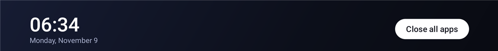
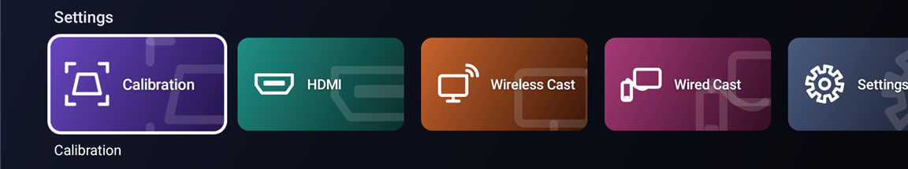
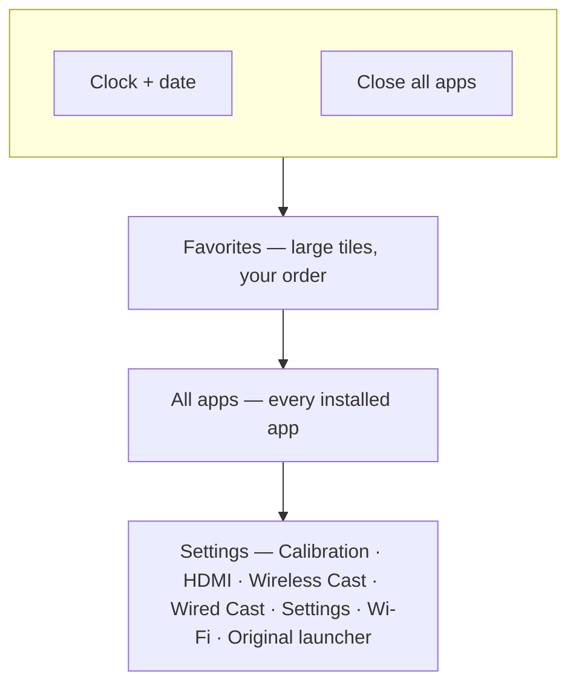
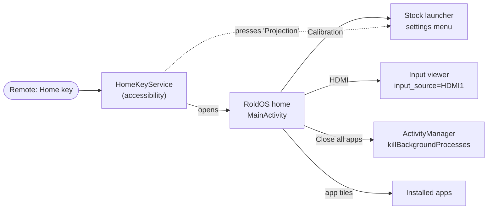
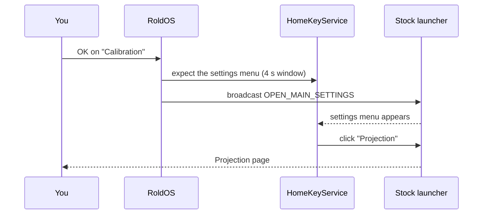

<div align="center">

# RoldOS

**A tiny, fast home screen for Android TV.**
Built for a 1 GB budget projector, it starts **3× faster** than Projectivy
Launcher in **half the memory**, from a **~45 KB** APK with zero libraries.


</div>

---

<p align="center">
  
  
</p>

> RoldOS is a **launcher**: it replaces the home screen and runs on top of the
> device's own Android.

## Why it exists

Budget projectors ship with heavy home screens full of ads, and the popular
replacement launchers are feature-rich but big. On a device with ~400 MB of free
memory, every megabyte the home screen holds is one the movie app can't use.

| Measured on the projector, 30 s after opening | Projectivy Launcher | **RoldOS** |
|---|---:|---:|
| Memory (PSS) | 131 MB | **56–68 MB** |
| Cold start | ~1.1 s | **~0.35 s** |
| APK size | several MB | **~45 KB** |

About 22 MB of RoldOS's memory is reserved by the GPU driver for any full-screen
app, so it's already close to the floor.

## What's on the screen



- **Every tile has its own look.** Apps that ship a TV banner use it. Apps that
  don't get one generated from their icon: a gradient in the icon's own colors, the
  icon, the name, and a large faded echo of the icon.
- **Settings row** puts the projector's controls one click away, all drawn in the
  same style:
  - **Calibration** jumps straight to the Projection page (keystone, zoom,
    installation mode, autofocus).
  - **HDMI** switches to the HDMI input.
  - **Wireless Cast** and **Wired Cast** open screen mirroring over Wi-Fi or USB.
  - **Settings** and **Wi-Fi** open the projector's own menus.
  - **Original launcher** visits the stock home screen. Home brings you back.
- **Close all apps** ends every app running in the background and tells you how
  much memory it freed. Music playing in the background keeps playing.
- **Favorites menu:** long-press OK (or press Menu) on any app to add, remove or
  move it, open its info, or uninstall it.
- **The Home button always works,** even on devices whose firmware hard-wires it to
  the stock launcher.

## How it works



The projector's stock launcher can't be removed: it hosts all calibration
(keystone, autofocus, projection mode). RoldOS leaves it running in the background
and talks to it the same way its own menus do. The Projection page is protected, so
for **Calibration** RoldOS opens the settings menu and its accessibility service
presses "Projection" for you:



### How it stays light

- Plain Android framework widgets only: no AndroidX, no Compose, no Gradle
  dependencies.
- One background thread. Tile art is rendered once, at exact size, into 16-bit
  bitmaps, and released when Android needs memory while another app is in front.
- No wallpapers, channels, previews or background services besides the tiny
  Home-key service.

## Build and install

Requirements (Windows): Android SDK (build-tools and a platform), the JDK bundled
with Android Studio, and Git Bash. No Gradle needed.

```bash
./build.sh                                # -> build/roldos.apk
adb connect <device-ip>:5555
./build.sh install <device-ip>:5555       # install, set as home, enable the Home key
```

`build.sh install` also re-enables the Home-key accessibility service, because
Android switches it off whenever an update changes what the service may do.

### Going back to the stock launcher for good

```bash
adb shell settings put secure enabled_accessibility_services ""
adb shell settings put secure accessibility_enabled 0
adb shell cmd package set-home-activity com.htc.luminaos/.activity.MainActivity
adb uninstall com.roldos   # optional
```

(For a quick visit, use the **Original launcher** tile instead.)

## Project layout

```
app/src/main/
├── AndroidManifest.xml
├── java/com/roldos/
│   ├── MainActivity.java     home screen: rows, tiles, focus, actions
│   ├── TileArt.java          all drawing: generated banners, Settings tiles
│   └── HomeKeyService.java   Home key + presses "Projection" for Calibration
└── res/                      strings (en, es), theme, accessibility config, icon
build.sh                      javac → d8 → aapt2 → zipalign → apksigner (+ install)
CLAUDE.md                     working notes for Claude Code
JOURNAL.md                    milestones, discoveries and decisions
```

## Compatibility

- **Tested on:** Magcubic projector, Allwinner H713, Android 11, 1 GB RAM.
- **Other Android TV devices:** projector-only tiles (Calibration, HDMI, casting,
  Original launcher) are hidden, and Settings / Wi-Fi open Android's own settings.
- **Close all apps** works fully up to Android 13. Android 14 stopped letting apps
  close other apps.

## License

[MIT](LICENSE) © 2026 Federico Roldos
