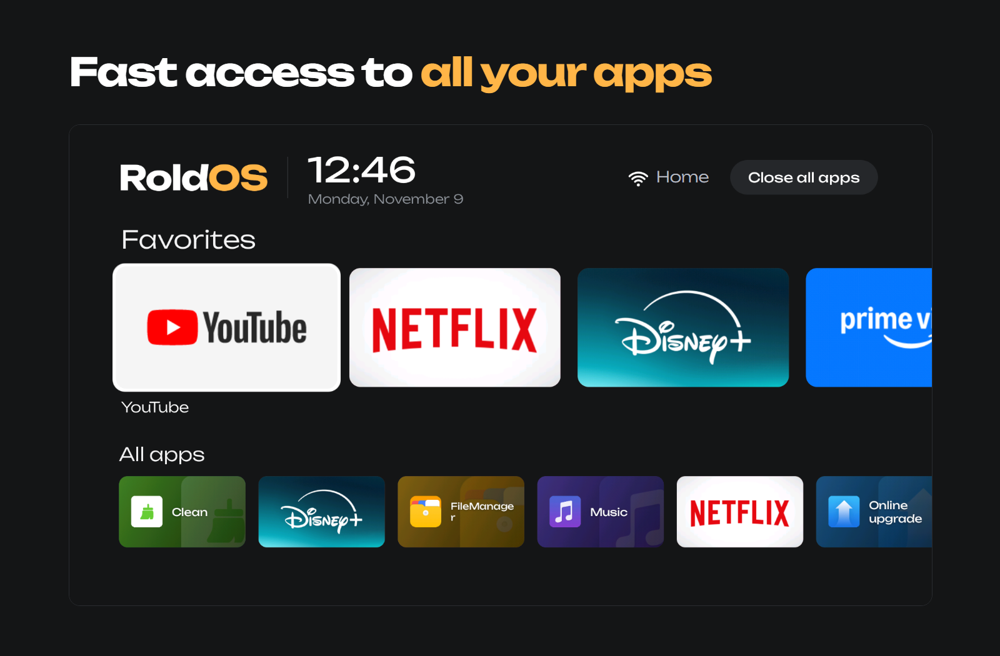
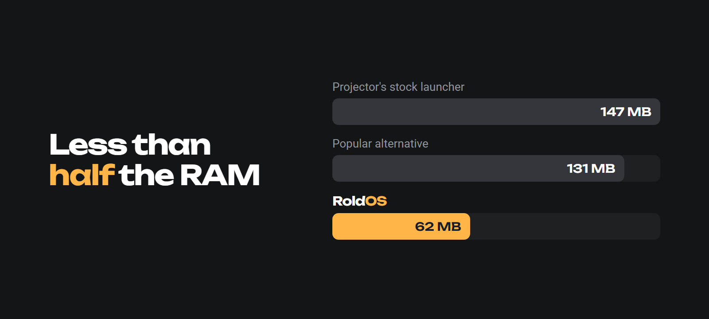
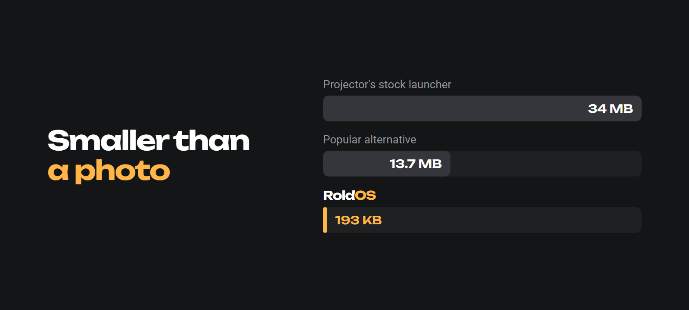
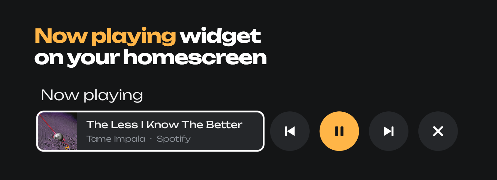
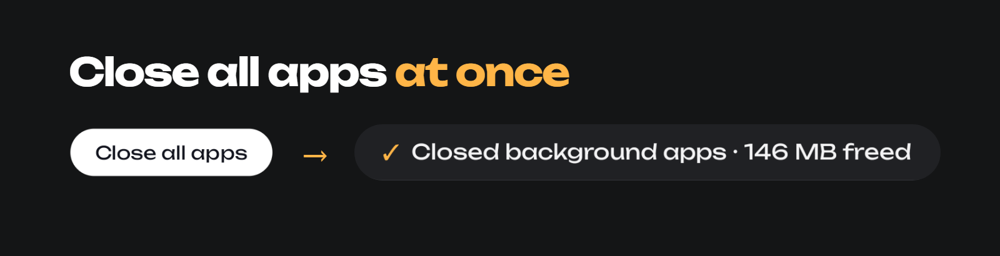
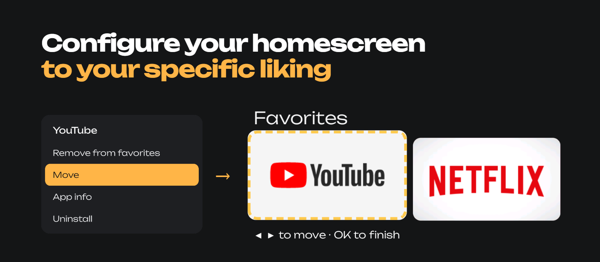

<p align="center">
  
</p>

<p align="center">
  
</p>

<p align="center">
  
</p>

<p align="center">
  
</p>

<p align="center">
  
</p>

<p align="center">
  
</p>

<p align="center">
  
</p>

<p align="center">
  
</p>

## Why you'll like it

- **Fast.** Opens in a third of a second.
- **Light.** No ads, no background clutter, zero libraries.
- **Pretty.** Every app gets its own tile design, even the ones that don't bring one.
- **Yours.** Hold OK on a favorite → **Move** → slide it where you want it.
- **Now playing.** Music or a video playing in the background? Pause, skip or close it right from the home.
- **One click to clean up.** *Close all apps* really closes them: YouTube, Netflix, Spotify and friends stay closed until you open them again.
- **Always home.** After a reboot or an update you land on RoldOS, not the stock launcher.

## Install

```bash
adb connect <device-ip>:5555
./build.sh install <device-ip>:5555
```

The first time you press *Close all apps*, Android asks to **allow debugging** for
`RoldOS@projector`. Tick **Always allow** and accept, once. Android only lets an app fully
close other apps through the device's own debug connection, so RoldOS uses it, inside the
device, for nothing else. Say no and it still closes them the gentle way.

**Let an AI do it all** (cleanup, apps, RoldOS): clone this repo, open your AI coding agent in
the folder and say *"set up my Android TV device following SETUP.md"*.

<sub>Measured on a Magcubic projector (Allwinner H713, 1 GB RAM, Android 11). Details in [JOURNAL.md](JOURNAL.md).</sub>

<p align="center"><sub><a href="LICENSE">MIT</a> © 2026 Federico Roldós</sub></p>
