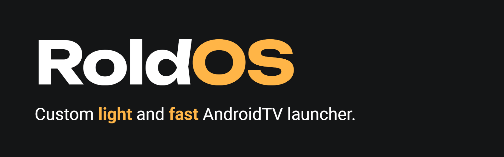
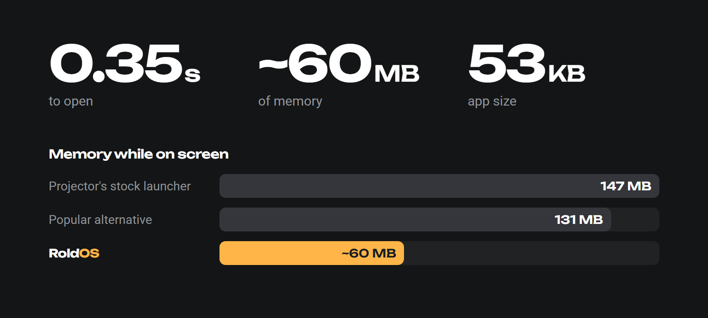
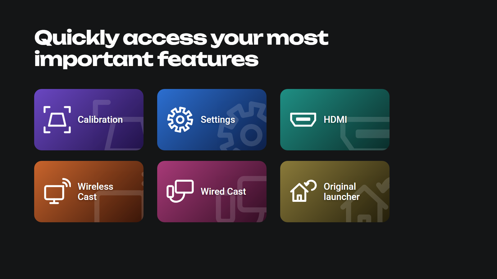

<p align="center">
  
</p>

<p align="center">
  
</p>

<p align="center">
  
</p>

## Why you'll like it

- **Fast.** Opens in a third of a second.
- **Light.** No ads, no background clutter, zero libraries.
- **Pretty.** Every app gets its own tile design, even the ones that don't bring one.
- **Yours.** Hold OK on a favorite → **Move** → slide it where you want it.
- **One click to clean up.** *Close all apps* frees memory whenever you want.

## Install

```bash
adb connect <device-ip>:5555
./build.sh install <device-ip>:5555
```

<sub>Measured on a Magcubic projector (Allwinner H713, 1 GB RAM, Android 11). Details in [JOURNAL.md](JOURNAL.md).</sub>

<p align="center"><sub><a href="LICENSE">MIT</a> © 2026 Federico Roldós</sub></p>
